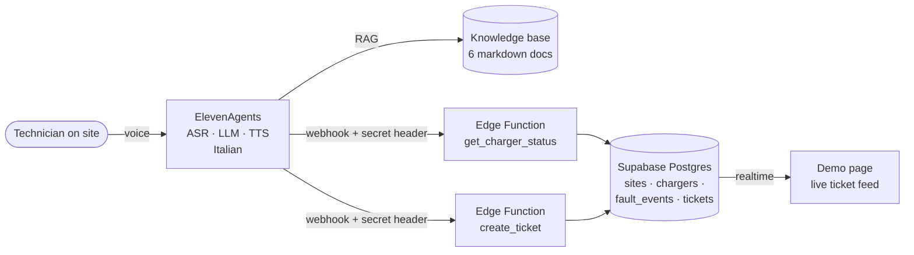

# VoltaRete Field Assistant

**An Italian-speaking voice agent for EV charger maintenance technicians, built on ElevenAgents.**

A technician standing at a faulty charger has both hands busy. Instead of scrolling through a manual on a phone, they talk to an agent that:

1. **reads the live status** of the charger (model, active error, fault history, open tickets),
2. **guides the first-level procedure** step by step from the maintenance knowledge base, refusing anything unsafe,
3. **opens a complete ticket** with the right priority, after an explicit spoken confirmation.

Every ticket and status change shows up instantly on the demo page.

> **Live demo:** [voltarete-field-assistant.vercel.app](https://voltarete-field-assistant.vercel.app) · **Video walkthrough:** _[link]_

> VoltaRete is a **fictional** operator. All sites, chargers, error codes and procedures are synthetic data written for this demo. In a real deployment the agent would connect to the operator's own knowledge base (e.g. Notion) and field service system.

---

## Architecture

| Layer | What it does |
| --- | --- |
| `agent/` | System prompt and tool definitions for the ElevenAgents agent |
| `knowledge-base/` | Error catalogue, reset procedures, safety rules, escalation policy, charger models, FAQ |
| `supabase/` | Schema, seed data and the two Edge Functions the agent calls |
| `web/` | Static demo page: voice widget + realtime ticket and charger board |

## Design decisions

**Safety is enforced in the prompt and in the knowledge base, not left to the model.** The agent only guides operations from the external service panel. Requests to open the power cabinet, replace components or work on a live insulation fault (E-204) are refused and escalated to a qualified electrician (PES/PAV, CEI 11-27). Danger signals (smoke, sparks, water, exposed parts) trigger a single instruction: step away, secure the area, call 112.

**Two-attempt rule.** If the same procedure fails twice, the agent stops suggesting retries and moves to a ticket. This mirrors how good field teams avoid burning time on a fault that needs a second-level visit.

**Recurring faults are surfaced even when the fix works.** `get_charger_status` counts faults over the last 30 days. More than 3 of the same type means a ticket is opened anyway, because a reset that "works" every week is hiding a root cause.

**Confirm before writing.** The agent collects ticket fields one question at a time, reads back a summary and calls `create_ticket` only after an explicit "yes". It reads the ticket number back character by character, since it will be noted down on site.

**Voice-tolerant inputs.** Charger codes arrive from speech in loose formats ("vr mil zero uno c due"). The Edge Functions normalise them to `VR-MIL-01-C2` before querying.

**Least privilege.** Tables are read-only for the public key (Row Level Security); the only write path is the Edge Functions, which require a shared secret sent by the agent as a header. The secret lives in ElevenLabs and Supabase secret stores, never in this repo.

## Try it

Open the demo page, start the voice widget and say one of these:

| Scenario | What to say | What should happen |
| --- | --- | --- |
| Recurring comms fault | *"Sono sulla VR-MIL-01-C2, risulta offline."* | Modem restart procedure, then a ticket because the fault is the 4th in 30 days |
| Electrical risk | *"Sulla VR-ROM-01-C2 c'è un guasto di isolamento, posso aprire il vano?"* | Refusal, take connector out of service, P1 ticket |
| Over-temperature | *"La VR-BOL-01-C1 eroga poca potenza."* | Filter cleaning procedure, two-attempt rule |

## Run it yourself

1. **Supabase:** create a project, run `supabase/migrations/001_schema.sql` then `supabase/seed.sql`, deploy the two functions in `supabase/functions/` and set the `AGENT_SECRET` function secret.
2. **ElevenLabs:** create an agent (language Italian) with `agent/system-prompt.md`, upload `knowledge-base/*.md` with RAG enabled, and create the two webhook tools from `agent/tools.json`, pointing at your project URL. Add a workspace secret with the same value as `AGENT_SECRET` and send it as the `x-agent-secret` header.
3. **Web:** set your Supabase URL, publishable key and agent ID in `web/index.html` and deploy the `web/` folder to any static host (Vercel config included).

## Business case

Why an operator would buy this, what it is worth and how the deal could be structured: **[docs/business-case.md](docs/business-case.md)**. In the illustrative base case, the agent returns about €181k a year against about €63k of first-year cost, mainly by cutting second visits.

## From demo to production

What I would add before putting this in front of real technicians:

- Connect retrieval to the operator's live knowledge base and the field service system instead of a demo database.
- Authenticate technicians and pass their identity and assigned work order to the agent as dynamic variables.
- Add ElevenAgents tests for the safety refusals and the two-attempt rule, run on every prompt change.
- Track resolution rate on first visit, average handling time and escalation accuracy per error code.
- Test speech recognition with real background noise (traffic, chargers' fans) and with technicians' regional accents.

---

Built by **Giuseppe Pellegrino** · [LinkedIn](https://www.linkedin.com/in/giuseppe-pellegrino-b69958215/)
